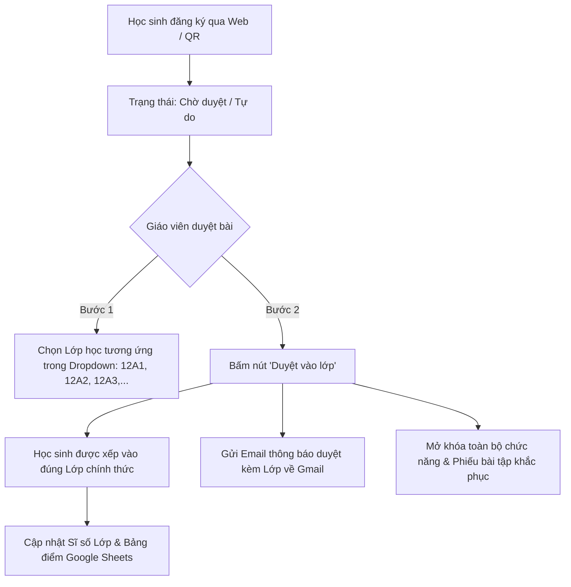

# ĐẶC TẢ TÍNH NĂNG QUẢN LÝ LỚP HỌC & PHÂN QUYỀN PHÊ DUYỆT HỌC SINH
## HỆ THỐNG DẠY HỌC & LUYỆN THI TOÁN THPT — HOCTOAN_THAYNHAN (PHIÊN BẢN v4.2)

---

### I. TỔNG QUAN TÍNH NĂNG

Hệ thống **hoctoan_ThayNhan** hỗ trợ quy trình quản trị lớp học và phân quyền học sinh khép kín theo chuẩn giáo dục THPT:
1. **Quản trị viên (Thầy Nhân)** có thể chủ động **tạo thêm các lớp học mới** (ví dụ: `12A1`, `12A2`, `12A3`, `11B1`, `10A1`,...) theo từng khối lớp và năm học.
2. Khi học sinh đăng ký tài khoản (qua Web hoặc quét mã QR), tài khoản ở trạng thái **Chờ duyệt (Tự do)**.
3. Giáo viên xem danh sách học sinh đăng ký, **chọn chính xác lớp học tương ứng từ menu thả xuống** để duyệt học sinh vào lớp đó.
4. Ngay khi bấm **"Duyệt vào lớp"**, hệ thống:
   - Gán học sinh vào đúng mã lớp (`classId`), tên lớp (`className`, `grade`).
   - Cập nhật sĩ số thực tế của lớp học.
   - Gửi email thông báo chính thức kèm tên lớp về địa chỉ Gmail của học sinh.
   - Kích hoạt toàn bộ quyền hạn cao cấp (AI phân tích lỗi sai gửi về Gmail & Phiếu bài tập khắc phục).
5. Giáo viên có thể **chuyển lớp** hoặc **hủy duyệt** bất kỳ lúc nào chỉ với 1 cú nhấp chuột.

---

### II. QUẢN LÝ DANH SÁCH LỚP HỌC (CLASS MANAGEMENT)

#### 1. Cấu trúc dữ liệu Lớp học (`classes`)
| Trường dữ liệu | Kiểu dữ liệu | Ý nghĩa & Ví dụ |
| :--- | :--- | :--- |
| `classId` | `TEXT (PK)` | Mã định danh duy nhất (VD: `CLS_12A1`, `CLS_12A2`, `CLS_12A3`, `CLS_11B1`) |
| `className` | `TEXT` | Tên lớp hiển thị (VD: `12A1`, `12A2`, `12A3`, `11B1`, `10A1`) |
| `grade` | `INTEGER` | Khối lớp (`10`, `11`, `12`) |
| `schoolYear` | `TEXT` | Năm học áp dụng (VD: `2025-2026`) |
| `code` | `TEXT` | Mã PIN tham gia lớp học (VD: `TOAN12A1`, `TOAN12A2`) |
| `description` | `TEXT` | Mục tiêu lớp (VD: *Lớp Toán Ôn thi TN THPT & HSG - Thầy Nhân*) |
| `teacherEmail` | `TEXT` | Email giáo viên phụ trách (`thaynhan.toanthpt@gmail.com`) |
| `studentCount` | `INTEGER` | Số lượng học sinh chính thức đã được duyệt vào lớp |
| `createdAt` | `ISO 8601` | Thời điểm tạo lớp học |

#### 2. Thao tác Tạo Lớp Học Mới
- **Tại Cổng Phê duyệt Học sinh (Tab 1)**: Nút **`➕ Tạo Lớp Học Mới`** mở biểu mẫu nhập nhanh:
  - Tên lớp (VD: `12A4`)
  - Khối lớp (Khối 10, 11, 12)
  - Năm học (mặc định: `2025-2026`)
  - Mô tả lớp
  - Bấm **`✓ Lưu Lớp Học Mới`** -> Hệ thống kiểm tra trùng lặp, thêm vào danh sách và đồng bộ tức thì sang toàn bộ menu.
- **Tại Trung tâm Quản trị Firestore (Tab 4 - Học sinh & Lớp)**: Khu vực **"Tạo Lớp Học Mới vào Firestore & Google Sheets"** hỗ trợ tạo và quản lý sĩ số tự động.

---

### III. QUY TRÌNH PHÊ DUYỆT HỌC SINH VÀO LỚP TƯƠNG ỨNG

#### 1. Bộ lọc học sinh theo Lớp học
- Thanh điều hướng thông minh cho phép Giáo viên lọc danh sách:
  - `Tất cả học sinh`: Toàn bộ học sinh trong cơ sở dữ liệu.
  - `Chờ duyệt vào lớp`: Các học sinh đăng ký trực tuyến chưa được phân lớp.
  - `Lớp 12A1`, `Lớp 12A2`, `Lớp 12A3`, `Lớp 11B1`,...: Xem riêng học sinh của từng lớp kèm sĩ số thực tế.

#### 2. Phê duyệt & Chuyển lớp
- **Duyệt học sinh mới**:
  - Tại cột **"Lớp phê duyệt (Chọn lớp duyệt)"**, giáo viên chọn lớp muốn xếp học sinh vào.
  - Bấm **`✓ Duyệt vào lớp`**: Tài khoản được kích hoạt ngay, trạng thái chuyển thành `✓ ĐÃ DUYỆT - LỚP [TÊN_LỚP]`.
- **Chuyển lớp cho học sinh đã duyệt**:
  - Khi học sinh chuyển từ lớp 12A1 sang 12A2, giáo viên chọn lớp mới và bấm **`🔄 Chuyển lớp`**.
  - Hệ thống tự động cập nhật lại sĩ số của cả 2 lớp và ghi nhận lịch sử vào sổ điểm.
- **Hủy duyệt**:
  - Bấm **`Hủy duyệt`**: Đưa tài khoản về dạng học sinh tự do (học miễn phí, khóa tính năng gửi Gmail bài khắc phục).
- **Duyệt hàng loạt**:
  - Nút **`✓ Duyệt tất cả (x học sinh chờ duyệt)`** tự động duyệt toàn bộ học sinh đang chờ vào đúng lớp mà các em đã đăng ký nguyện vọng.

---

### IV. SO SÁNH QUYỀN HẠN 2 DẠNG HỌC SINH

| Chức năng hệ thống | 🆓 Học sinh Tự do (Học Miễn phí) | ✓ Học sinh Đã duyệt Vào Lớp |
| :--- | :---: | :---: |
| **Phân bổ vào Lớp học chính thức** | ❌ Chưa phân lớp | ✅ Có tên trong danh sách Lớp |
| **Tự học Lý thuyết trọng tâm 5 Bài KNTT** | ✅ Mở toàn bộ | ✅ Mở toàn bộ |
| **Luyện 27 Dạng bài tập SGK KNTT** | ✅ Mở toàn bộ (5–10 bài/dạng) | ✅ Mở toàn bộ (5–10 bài/dạng) |
| **Làm Đề kiểm tra chuẩn CV 7991 (Dạng 1 & Dạng 2)** | ✅ Xem điểm số trực tiếp | ✅ Xem điểm số & Sổ học bạ |
| **Đồng hồ làm bài & Giám sát Chống gian lận** | ✅ Đầy đủ | ✅ Đầy đủ |
| **AI Gemini chẩn đoán lỗi sai gửi về Gmail** | 🔒 **Khóa (Không gửi Gmail)** | ✅ **Gửi chi tiết về Gmail** |
| **Phiếu bài tập khắc phục điểm yếu cá nhân hóa** | 🔒 **Khóa** | ✅ **Mở khóa toàn bộ (+100 XP)** |
| **Xuất Phiếu báo điểm cá nhân chuẩn in ấn** | 🔒 **Khóa** | ✅ **Xuất Excel (.xlsx) / In PDF** |

---

### V. TÍCH HỢP ĐỒNG BỘ GOOGLE SHEETS & FIRESTORE

1. **Google Sheets - Sheet `LOP_HOC`**:
   - Tự động ghi nhận danh sách lớp: `classId`, `className`, `grade`, `schoolYear`, `studentCount`.
2. **Google Sheets - Sheet `HOC_SINH`**:
   - Lưu trữ: `studentId`, `fullName`, `className`, `grade`, `status` (`approved` / `pending`).
3. **Google Sheets - Sheet `KET_QUA`**:
   - Khi học sinh nộp bài thi, kết quả được gán chính xác theo cột `Lớp` tương ứng đã được duyệt.